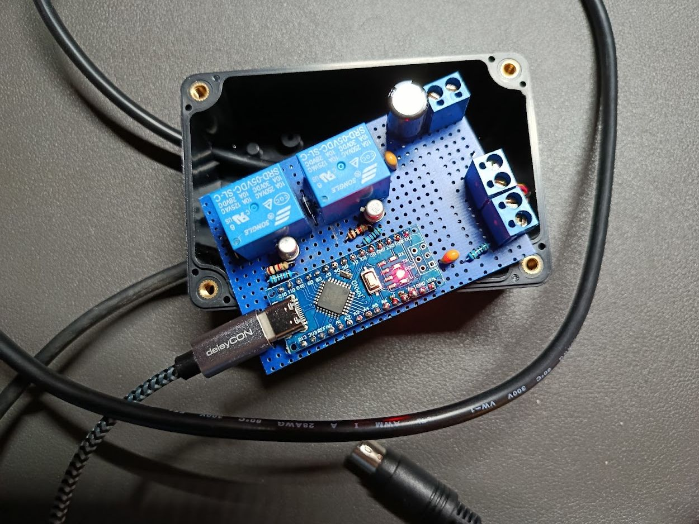
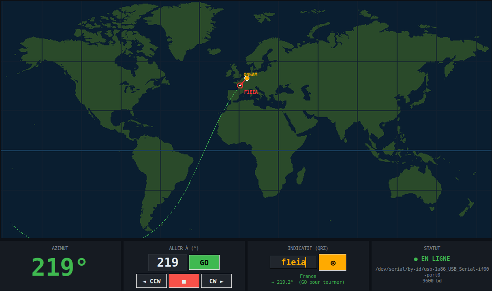
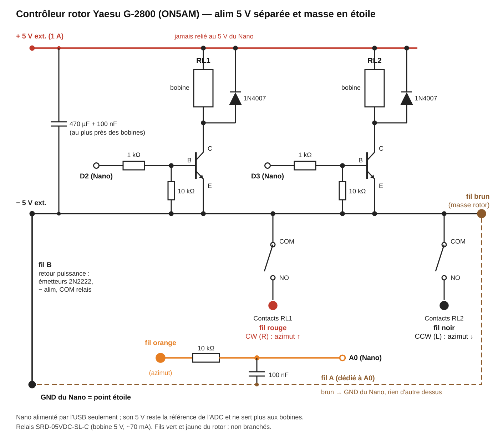

[Version française](README.fr.md)

# DIY controller for the Yaesu G-2800DXC rotator (ON5AM)

Control a Yaesu G-2800DXC azimuth rotator from a PC with an Arduino Nano and two relays, using the Yaesu GS-232A protocol.

The Nano is wired to the external control socket of the rotator's control box. It reads the azimuth from the box's analog output and answers a subset of the **Yaesu GS-232A** protocol, so it works with tracking software that speaks this protocol. A Python GUI is included: world map, QRZ callsign lookup, bearing line to the target.

Full write-up (construction, measurements), in French: [Contrôleur DIY rotor Yaesu G-2800 : Arduino Nano et GS-232A](https://hamanalyst.org/controleur-rotor-yaesu-g2800-arduino/) on hamanalyst.org





> ⚠️ Amateur build, tested on a single rotator (G-2800DXC). Read the **Safety** section before the first test.

## Features

- **GS-232A subset** over USB serial at 9600 baud: `C`, `M`, `W`, `R`, `L`, `A`, `S`.
- **Two-stage positioning**: rotation guided by the reading while moving, then a check at rest and short timed correction pulses (stop tolerance ±2°).
- **6-point calibration** (ADC → degrees) with linear interpolation, plus two diagnostic commands: `\R` (raw ADC) and `\B` (internal 1.1 V reference, to check the 5 V supply).
- **Firmware safety**: CW/CCW interlock, 1 s pause on direction reversal, 0–360° software limit, stall detection, 300 s timeout, no relay energised at power-up.
- **Tkinter GUI**: world map in Miller projection, great-circle bearing from your station, QRZ.com lookup (XML subscription required), click-on-map targeting, F11 full screen. The GUI labels are in French.
- **Test scripts** for each step of the build: serial link, relays, calibration, positioning, 5 V under load.

## Repository contents

| Folder / file | Purpose |
|---|---|
| `firmware/rotor_k3ng_ON5AM/rotor_k3ng_ON5AM.ino` | Nano firmware (GS-232A, safety, calibration) |
| `scripts/rotor_control.py` | Graphical interface (Tkinter) |
| `scripts/world_map.png` | GUI base map (Miller projection, from Natural Earth) |
| `scripts/test_comm.py` | Communication test (banner + 15 azimuth readings) |
| `scripts/calib_read.py` | Records one calibration point (20 raw ADC readings) |
| `scripts/relay_test.py` | Relay test |
| `scripts/pas_rotor.py` | Small R → L step with a ±20° guard |
| `scripts/m_test.py` | Timed `M <target>` test, with guards |
| `scripts/goto_test.py` | Positioning test |
| `scripts/b_rotation.py` | 5 V check under load: R rotation for N seconds while reading `\B` |
| `docs/schema_rotor_g2800.svg` / `.png` | Schematic |
| `docs/plan_plaque_rotor_g2800.svg` | Perfboard layout |
| `docs/guide_plaque_rotor_g2800.md` | Board assembly guide, wire list, checks (in French) |
| `tools/gen_world_map.py` | Regenerates `world_map.png` from the Natural Earth land data |
| `docs/appli-rotor.png` | GUI screenshot |
| `docs/Rotor-final1.jpg` | Photo of the finished controller |
| `rotor_config.example.ini` | Local configuration template |

## Hardware

| Qty | Part | Note |
|---|---|---|
| 1 | Arduino Nano (ATmega328P, CH340) | Powered from the PC's USB; its 5 V is the ADC reference |
| 2 | **SRD-05VDC-SL-C** relay (5 V coil, ≈ 70 mA) | RL1 = R rotation (CW), RL2 = L rotation (CCW) |
| 2 | **2N2222** transistor | Coil drivers (D2 / D3 HIGH → relay energised) |
| 2 | 1N4007 diode | Flyback diode on each coil |
| 2 | 1 kΩ resistor | Transistor bases |
| 3 | 10 kΩ resistor | Base pull-downs to ground; A0 input |
| 2 | 100 nF capacitor | A0 filter; coil decoupling |
| 1 | 470 µF / 10 V capacitor | Reservoir on the coil 5 V |
| 1 | **Separate 5 V supply** (≥ 500 mA) | Coils only; **never connected to the Nano's 5 V** |
| 1 | Perfboard 34 × 26 holes, 2- and 4-way terminal blocks | See `docs/` |

**Why a separate supply for the coils?** The Nano's USB 5 V is also the reference for the azimuth measurement. With the coils powered from the Nano, the supply dropped by 3 % each time a relay closed and the reading was off by 5 to 10° during rotation. With the separate 5 V and a star ground, the drop is about 1.6 % (4.53 → 4.45 V, identical on ICSP, the +5V pin and REF) and the error is 2 to 4°.



## Wiring

### Rotator control cable (external socket of the G-2800 control box)

Wiring **checked on the rotator** (control box needle): relay RL1, driven by the R command, must make the azimuth **increase**.

| Cable wire | Function | Connected to | Terminal J1 |
|---|---|---|---|
| **Brown** | Control box ground | Ground bus (and wire A to the Nano's GND, see below) | AG18 |
| **Orange** | Azimuth voltage (≈ 0.09 V at 0°, ≈ 3.4 V at 360°) | 10 kΩ → A0, 100 nF to ground | AG24 |
| **Red** | **R / CW** rotation (azimuth ↑) when pulled to ground | NO contact of **RL1** (driven by **D2**) | AG20 |
| **Black** | **L / CCW** rotation (azimuth ↓) when pulled to ground | NO contact of **RL2** (driven by **D3**) | AG22 |
| Green, yellow | — | **Not connected** | — |

The COM contacts of both relays go to ground. The control box's speed pin is not used: under external control the rotator turns at about **2.0 to 2.5°/s** (≈ 4.5°/s from the front panel).

> Do not trust pinouts found on the web or assumed wire colours: check the direction on the control box needle. **If R makes the needle go down, swap RED and BLACK** on the terminal block.

### Arduino Nano

| Pin | Connection |
|---|---|
| D2 | 1 kΩ → base of Q1 (2N2222) → RL1 coil |
| D3 | 1 kΩ → base of Q2 (2N2222) → RL2 coil |
| A0 | Orange wire through 10 kΩ, 100 nF to the ground of wire A |
| GND (wire A) | Rotator brown wire + the A0 100 nF: measurement ground, nothing else |
| GND (wire B) | Power ground bus: emitters, relay COMs, − of the 5 V supply |
| +5V | **Not used** |

The two grounds only meet at the Nano's GND (star ground). Details, wire list and checks before power-up: `docs/guide_plaque_rotor_g2800.md` (in French).

## Installation

### Firmware

1. Open `firmware/rotor_k3ng_ON5AM/rotor_k3ng_ON5AM.ino` in the Arduino IDE.
2. Board: **Arduino Nano**. Processor: **ATmega328P (Old Bootloader)** for the common CH340 clones (upload at 57600 baud).
3. Upload. **Keep the rotator control box switched off during the upload**, or unplug the rotator terminal block.

At start-up the Nano sends `K3NG Rotor ON5AM v1.0` on the serial port at 9600 baud.

### GUI and scripts

```bash
python3 -m pip install pyserial pillow numpy   # tkinter: python3-tk package on Debian/Ubuntu
cp rotor_config.example.ini scripts/rotor_config.ini
# edit scripts/rotor_config.ini (serial port, station, QRZ)
python3 scripts/rotor_control.py
```

On Linux, the user must be a member of the `dialout` group to access the serial port.

## Configuration: `scripts/rotor_config.ini`

`rotor_config.ini` goes **next to `rotor_control.py`**. It is excluded from the repository by `.gitignore`: your credentials must not appear anywhere else.

```ini
[serie]
port = /dev/serial/by-id/usb-1a86_USB_Serial-if00-port0
baud = 9600

[station]
lat = 50.6458
lon = 5.5417

[qrz]
user = YOUR_CALLSIGN
password = YOUR_PASSWORD
key =
```

The section names (`serie`, `station`, `qrz`) are read by the code: keep them as they are.

- **Serial port**: on Linux, prefer the stable path `/dev/serial/by-id/…` (`ls -l /dev/serial/by-id/`) to the `/dev/ttyUSBx` name, which can change. With no port configured, the GUI does not connect to anything.
- **Station**: coordinates of your antenna (decimal degrees, East and North positive). They are used to compute bearings and draw the map.
- **QRZ**: QRZ.com credentials. Callsign lookup uses the QRZ XML API, which requires an XML subscription.
- The environment variables `ROTOR_PORT`, `ROTOR_QRZ_USER`, `ROTOR_QRZ_PASS` and `ROTOR_QRZ_KEY` take precedence over the file.
- The test scripts have their port written in the file: `PORT` constant at the top of `calib_read.py`, `goto_test.py`, `m_test.py`, `pas_rotor.py` and `relay_test.py`; directly in the `serial.Serial(...)` call in `test_comm.py` and `b_rotation.py`. Adjust it if needed.

## Usage

| Serial command (9600 baud, `\r` line ending) | Effect |
|---|---|
| `C` | Current azimuth, reply `+0XXX` |
| `M xxx` / `W aaa eee` | Go to azimuth xxx (elevation ignored) |
| `R` / `L` | Continuous rotation CW / CCW |
| `A` / `S` | Stop (`S` replies `OK`) |
| `\R` | Raw ADC value (calibration) |
| `\B` | Internal 1.1 V reference (5 V diagnostic) |

In the GUI: **GO** sends `M`, the **◄ CCW / ■ / CW ►** buttons send `L`, `S`, `R`. A QRZ lookup or a click on the map fills in the bearing field **without starting the rotation**: press GO to turn. The red line goes to the target; the green dotted line follows the antenna's actual heading. F11: full screen, Esc to leave it. Closing the window sends `S`.

## 6-point calibration

The ADC → degrees conversion is a 6-point table written in the firmware (`CAL_ADC` / `CAL_DEG`), with linear interpolation between points.

1. Move the rotator **with the front panel buttons** to each needle mark: **0° end stop, 90°, 180°, 270°, 360°, then the "30" mark of the overlap zone (= 390°)**.
2. At each point, with the needle at rest: `python3 scripts/calib_read.py "180 (needle 180)"` (20 readings of `\R`, average saved to `scripts/calib_releves.txt`).
3. Copy the rounded averages into the firmware, for example:
   ```c
   const int CAL_ADC[] = { 17, 198, 389, 587, 777, 840 };
   const int CAL_DEG[] = {  0,  90, 180, 270, 360, 390 };
   ```
   Map the end stop to **0°** (not 1°): the software limit then refuses L at the end stop.
4. Upload, then check at rest with `C` at two or three marks.

The calibration depends on the Nano's 5 V. **Redo it after any change** of Nano, USB cable, hub or PC, or if the error against the needle exceeds 2°.

## Safety

- **First tests in small steps** (±5 to 10°), eyes on the needle, with the `S` command (or the ■ button) at hand.
- **Test the relays with the rotator disconnected** first (`docs/guide_plaque_rotor_g2800.md`, checks 1 to 4): one relay at a time, never both.
- **Check the direction** (R = azimuth increasing) before using `M`: with the direction reversed, the software limit and `M` work backwards.
- **Never connect the green and brown wires to the Nano's ground**: on the test setup this made the rotator turn non-stop.
- Firmware safety features:
  - interlock: the two relays are never energised together; **1 s pause** with relays released on every direction reversal;
  - **0–360° software limit** (the 360–450° overlap is not used);
  - **stall detection**: relay energised without a 2° change in 5 s → stop (mechanical end stop, ice, control box switched off);
  - **300 s timeout** without a new movement command → stop. A full 0 → 360° travel takes about 150 to 180 s under external control;
  - no relay energised when the Nano starts.
- The rotator's **mechanical end stops** remain the last line of protection: the software limit depends on a correct azimuth reading. A switched-off control box or an unplugged azimuth wire reads as 0°.

## Credits

Base map: *Made with Natural Earth. Free vector and raster map data @ [naturalearthdata.com](https://www.naturalearthdata.com/)* (public domain). 1:50 M land, Miller projection, generated by `tools/gen_world_map.py`.

## Contributing

Issues and pull requests are welcome. Commit messages are in English: see [CONTRIBUTING.md](CONTRIBUTING.md).

## License

This project is distributed under the **GNU General Public License v3.0**: see the [`LICENSE`](LICENSE) file.

The firmware is an original implementation of the GS-232A protocol. It does not reuse code from the [K3NG rotator controller](https://github.com/k3ng/k3ng_rotator_controller), also GPL-3.0, and only keeps its name in the start-up banner.

## Author

Albert, **ON5AM** — [hamanalyst.org](https://hamanalyst.org/)

---
73 de ON5AM
