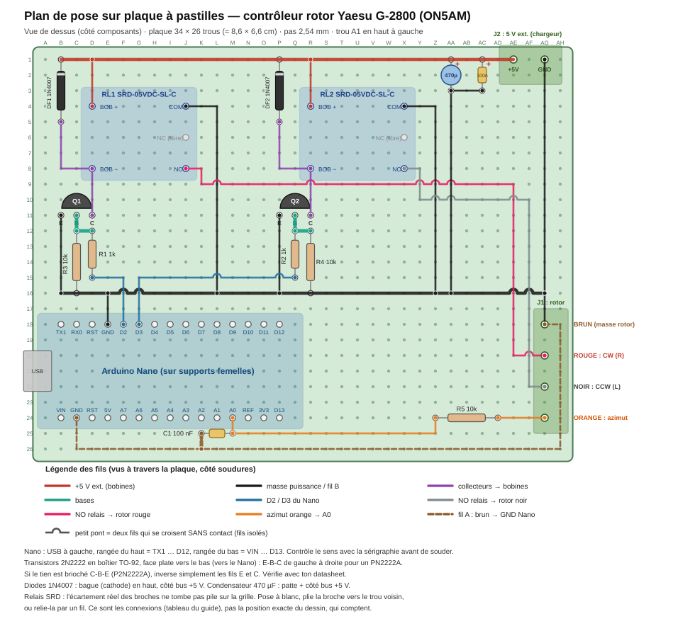

# Plan de pose sur plaque à pastilles — contrôleur rotor Yaesu G-2800 (ON5AM)

Ce plan reprend le montage validé sur table (voir `schema_rotor_g2800.svg`) : Nano en USB, relais alimentés par un 5 V séparé, masse en étoile (fil A pour l'azimut, fil B pour le retour des transistors). Il n'a pas encore été monté : la liste des connexions a été vérifiée par script contre le schéma (aucun court-circuit, aucun fil oublié ou superposé), mais pas sur une vraie plaque.

## Repérage
- Vue de dessus (côté composants), pas 2,54 mm, **colonnes A → AH, rangées 1 → 26**, trou **A1 en haut à gauche**.
- Format utile : **34 × 26 trous** (≈ 8,6 × 6,6 cm). Une plaque 7 × 9 cm (35 × 27 trous) passe juste ; une 9 × 12 cm laisse de la marge.
- Les fils se soudent **côté soudures** (dessous) ; ils sont dessinés en couleur comme si la plaque était transparente. Un petit pont sur le dessin signale deux fils qui se croisent sans contact.

## Matériel
| Qté | Composant |
|---|---|
| 1 | Arduino Nano (CH340) + 2 barrettes femelles 15 points |
| 2 | Relais SRD-05VDC-SL-C |
| 2 | Transistor 2N2222 (TO-92) |
| 2 | Diode 1N4007 |
| 2 | Résistance 1 kΩ (R1, R2) |
| 3 | Résistance 10 kΩ (R3, R4, R5) |
| 2 | Condensateur 100 nF (C1, C3) |
| 1 | Condensateur électrolytique 470 µF / 10 V ou plus (C2) |
| 1 | Bornier à vis 2 points, pas 5,08 mm (J2) |
| 1 | Bornier à vis 4 points, pas 5,08 mm (J1) |
| 1 | Plaque à pastilles pas 2,54 mm, 34 × 26 trous minimum |
| - | Fil de câblage isolé fin en plusieurs couleurs, un peu de fil nu étamé pour les 2 bus |
| 1 | Chargeur 5 V ≥ 500 mA (alim des bobines) et câble USB (alim + liaison du Nano) |

## Où va chaque composant
| Composant | Trous |
|---|---|
| Arduino Nano sur 2 barrettes femelles 15 pts | rangée haut : B18 → P18 (TX1 … D12) ; rangée bas : B24 → P24 (VIN … D13) |
| RL1 (CW, rouge) SRD-05VDC-SL-C | bobine + D4 · bobine − D8 · COM J4 · NO J8 · NC J6 (libre) |
| RL2 (CCW, noir) SRD-05VDC-SL-C | bobine + R4 · bobine − R8 · COM X4 · NO X8 · NC X6 (libre) |
| Q1 2N2222 (voie D2/CW) | E B11 · B C11 · C D11 |
| Q2 2N2222 (voie D3/CCW) | E P11 · B Q11 · C R11 |
| DF1 1N4007 (bobine RL1) | cathode (bague) B1 · anode B5 |
| DF2 1N4007 (bobine RL2) | cathode (bague) P1 · anode P5 |
| R1 1 kΩ (D2 → base Q1) | D12 – D15 |
| R2 1 kΩ (D3 → base Q2) | Q12 – Q15 |
| R3 10 kΩ (base Q1 → masse) | C12 – C16 |
| R4 10 kΩ (base Q2 → masse) | R12 – R16 |
| R5 10 kΩ (orange → A0) | AD24 – Z24 |
| C1 100 nF (A0 → fil A) | M25 – K25 |
| C2 470 µF électrolytique | + AA1 · − AA3 |
| C3 100 nF | AC1 – AC3 |
| J2 bornier 2 pts (5 V ext. + / GND) | +5V AE1 · GND AG1 |
| J1 bornier 4 pts (rotor) | BRUN AG18 · ROUGE AG20 · NOIR AG22 · ORANGE AG24 |

Broches du Nano utilisées : **D2** F18, **D3** G18, **GND (fil B)** E18, **A0** M24, **GND (fil A)** C24.

## Liste des fils
`pont` = simple pont de soudure entre deux trous voisins. `bus` = fil nu étamé soudé sur toute la rangée.

| # | Fil | De | Via | À | Type |
|---|---|---|---|---|---|
| 1 | Bus +5 V ext | B1 | — | AE1 | bus |
| 2 | Bus masse puissance (fil B) | B16 | — | AG16 | bus |
| 3 | RL1 bobine + vers bus +5 V | D4 | — | D1 | wire |
| 4 | Anode DF1 vers bobine − RL1 | B5 | B8 | D8 | wire |
| 5 | Collecteur Q1 vers bobine − RL1 | D11 | — | D8 | wire |
| 6 | Émetteur Q1 vers bus masse | B11 | — | B16 | wire |
| 7 | Pont base Q1 | C11 | — | C12 | pont |
| 8 | Pont R1/R3 | C12 | — | D12 | pont |
| 9 | R1 vers D2 du Nano | D15 | F15 | F18 | wire |
| 10 | COM RL1 vers bus masse | J4 | L4 | L16 | wire |
| 11 | NO RL1 vers bornier ROUGE | J8 | K8 → K9 → AE9 → AE20 | AG20 | wire |
| 12 | RL2 bobine + vers bus +5 V | R4 | — | R1 | wire |
| 13 | Anode DF2 vers bobine − RL2 | P5 | P8 | R8 | wire |
| 14 | Collecteur Q2 vers bobine − RL2 | R11 | — | R8 | wire |
| 15 | Émetteur Q2 vers bus masse | P11 | — | P16 | wire |
| 16 | Pont base Q2 | Q11 | — | Q12 | pont |
| 17 | Pont R2/R4 | Q12 | — | R12 | pont |
| 18 | R2 vers D3 du Nano | Q15 | G15 | G18 | wire |
| 19 | COM RL2 vers bus masse | X4 | Z4 | Z16 | wire |
| 20 | NO RL2 vers bornier NOIR | X8 | Y8 → Y10 → AF10 → AF22 | AG22 | wire |
| 21 | C2 (−) vers bus masse | AA3 | — | AA16 | wire |
| 22 | C3 (−) vers C2 (−) | AC3 | — | AA3 | wire |
| 23 | Bornier J2 GND vers bus masse | AG1 | — | AG16 | wire |
| 24 | Bornier BRUN vers bus masse | AG18 | — | AG16 | wire |
| 25 | Fil B : bus masse vers GND du Nano | E16 | — | E18 | wire |
| 26 | Bornier ORANGE vers R5 | AG24 | — | AD24 | wire |
| 27 | R5 vers condensateur C1 / A0 | Z24 | Z25 | M25 | wire |
| 28 | C1 (A0) vers broche A0 du Nano | M25 | — | M24 | wire |
| 29 | C1 (masse) vers fil A | K25 | — | K26 | pont |
| 30 | Fil A (1/2) : BRUN vers C1 | AG18 | AH18 → AH26 | K26 | wire |
| 31 | Fil A (2/2) : C1 vers GND du Nano | K26 | C26 | C24 | wire |

## Ordre de montage conseillé
1. Souder les deux barrettes femelles **avec le Nano enfiché** pour garder le bon écartement.
2. Borniers J1 et J2, puis relais (pose à blanc d'abord), transistors, diodes, résistances, condensateurs.
3. Les deux bus (rangée 1 = +5 V, rangée 16 = masse), puis les fils dans l'ordre de la liste.
4. Terminer par le fil A (en pointillés marron sur le dessin), qui ne doit toucher aucun autre fil.

## Contrôles avant la première mise sous tension
1. **Sans Nano, sans alim**, au multimètre : pas de court-circuit entre le + et le − de J2 (jamais moins de quelques kΩ, dans les deux sens de la sonde).
2. Continuité attendue : les deux COM, les deux émetteurs et le brun à la masse ; **A0 isolé de la masse** (il y a un 10 kΩ puis le 100 nF, pas de continuité franche).
3. **Alim 5 V ext. seule**, Nano absent : aucun relais ne doit coller, le courant doit être nul.
4. Nano en place, USB branché, rotor **débranché** : lancer `relay_test.py`, vérifier à l'oreille et en continuité COM–NO que RL1 colle sur D2 et RL2 sur D3, jamais ensemble.
5. Seulement ensuite, brancher le rotor et reprendre la liste de tes étapes (R/L/A/S près du rotor, A0, étalonnage).

## Points à vérifier sur tes pièces réelles
- **Sens du Nano** : le plan suppose l'USB à gauche et TX1 … D12 sur la rangée du haut. Contrôle avec la sérigraphie.
- **2N2222** : le dessin suppose E-B-C de gauche à droite, face plate vers le bas (PN2222A). Si le tien est C-B-E (P2N2222A), inverse les fils E et C.
- **Relais SRD** : l'écartement réel des broches ne tombe pas pile sur la grille 2,54 mm. Pose-les à blanc, plie la broche vers le trou voisin ou relie-la par un fil. Identifie les broches au multimètre : bobine ≈ 70 Ω entre deux broches ; COM–NC conduit au repos, COM–NO non.
- **Diodes** : bague (cathode) côté bus +5 V. **C2** : patte + côté bus +5 V.
- Les deux masses du Nano (fil A et fil B) arrivent chacune sur leur broche GND ; ne les relie pas entre elles ailleurs.
